# BLT-DD Prioritas — Flutter Cross-Platform

Prototipe akademik untuk mencatat data simulasi calon penerima BLT-DD, menilai tujuh kriteria kerentanan, lalu meninjau urutan prioritas. Satu basis kode Flutter dijalankan sebagai aplikasi Web dan Android.

> **Status jujur:** aplikasi berjalan dalam **mode demo** (data di memori) dan sudah diuji otomatis dengan `flutter analyze` + `flutter test`. Integrasi Firebase Authentication dan Cloud Firestore tersedia di kode, tetapi **belum dihubungkan ke project Firebase nyata dan belum diuji**. Firebase Hosting belum di-deploy. APK debug berhasil dibangun melalui GitHub Actions, tetapi belum dijalankan di perangkat/emulator. Semua nama calon dan nilai adalah data sintetis; skor bukan keputusan resmi penerima bantuan.

**Akses demo web:** https://bamsuti.github.io/BLT-DD-prioritas/ — diterbitkan melalui GitHub Pages, berjalan dalam mode demo dengan akun `demo@blt-dd.local` / `demo123`.

## Identitas proyek

| Item | Keterangan |
|---|---|
| Judul | Perancangan Aplikasi Penentuan Prioritas Calon Penerima BLT-DD Berbasis Cross-Platform Menggunakan Flutter dan Firebase |
| Mahasiswa | Nabhan Miqdad Mubarok |
| NIM | 23.01.55.0017 |
| Kelas | A1 |
| Mata kuliah | Mobile and Web Application Development |
| Periode | Ganjil 2026/2027 |
| Repository | https://github.com/Bamsuti/BLT-DD-prioritas |
| Demo web | https://bamsuti.github.io/BLT-DD-prioritas/ |
| Proposal UTS | [docs/proposal/PROPOSAL_UTS.pdf](docs/proposal/PROPOSAL_UTS.pdf) |
| Video presentasi | [docs/video/blt-dd-prioritas-promo.mp4](docs/video/blt-dd-prioritas-promo.mp4) |
| Versi aplikasi | 1.0.0+1 |

## Masalah dan tujuan

Pendataan calon, pembaruan nilai, dan peninjauan peringkat sulit ditelusuri bila dikelola dalam beberapa spreadsheet terpisah. Prototipe ini menyatukan login petugas, pengelolaan data calon, penilaian tujuh kriteria, dan hasil prioritas dalam satu aplikasi responsif.

Ruang lingkup dibatasi pada:

- pengelolaan data simulasi dan perhitungan skor demo;
- tidak menangani pencairan dana atau integrasi sistem pemerintah;
- tidak memakai data warga nyata;
- tidak menggantikan verifikasi lapangan maupun musyawarah desa.

## Fitur yang tersedia

| Fitur | Keterangan | Status |
|---|---|---|
| Login petugas | Validasi email/kata sandi, indikator proses, pesan gagal, logout | Berfungsi di mode demo, diuji otomatis |
| Login Firebase | Email/Password via Firebase Authentication saat konfigurasi tersedia; sesi tersimpan dipulihkan; pesan kesalahan Bahasa Indonesia | Kode siap; belum diuji tanpa project Firebase nyata |
| Mode demo eksplisit | Akun lokal sintetis, label "Mode demo" pada layar | Berfungsi, diuji otomatis |
| Beranda | Jumlah calon, jumlah kriteria, jumlah hasil dihitung dari data termuat; pintasan navigasi | Berfungsi |
| Data calon (CRUD) | Tambah, lihat, ubah, hapus dengan dialog konfirmasi | Berfungsi di mode demo, diuji otomatis |
| Validasi form | ID simulasi, nama, dusun wajib; ID duplikat ditolak; tujuh nilai kriteria | Berfungsi, diuji otomatis |
| Penilaian | Tujuh kriteria + bobot demo + tombol isi nilai | Berfungsi |
| Hasil prioritas | Skor 0–100, urut menurun, penjelasan rumus, disclaimer | Berfungsi |
| Navigasi responsif | `NavigationBar` (< 760 px) dan `NavigationRail` (≥ 760 px) | Berfungsi, diuji otomatis |
| Firebase Auth + Firestore | Kode siap, aktif hanya bila konfigurasi `--dart-define` lengkap dan inisialisasi sukses | Belum diuji dengan project nyata |

## Tujuh kriteria dan bobot demo

| Kode | Kriteria | Bobot |
|---|---|---|
| C1 | Penghasilan keluarga | 20% |
| C2 | Jumlah tanggungan | 15% |
| C3 | Kondisi dinding | 15% |
| C4 | Kondisi lantai | 15% |
| C5 | Akses air bersih | 10% |
| C6 | Sumber penerangan | 10% |
| C7 | Tabungan keluarga | 15% |
| | **Total** | **100%** |

Skala nilai 1–5, di mana **nilai lebih tinggi berarti kondisi lebih rentan**. Karena itu seluruh kriteria diperlakukan sebagai *benefit* pada perhitungan demo.

Rumus SAW (Simple Additive Weighting) demo:

```
rᵢⱼ = xᵢⱼ / 5
Vᵢ  = Σ (wⱼ × rᵢⱼ)          untuk tujuh kriteria
Skor = Vᵢ × 100
```

Contoh: SIM-001 memiliki nilai C1–C7 = 5, 4, 4, 4, 3, 4, 5.

```
V = (0,20×1,0) + (0,15×0,8) + (0,15×0,8) + (0,15×0,8)
  + (0,10×0,6) + (0,10×0,8) + (0,15×1,0) = 0,85
Skor akhir = 85,0
```

Bobot, skala, dan arah benefit/cost masih asumsi demo dan belum divalidasi dengan dosen atau ketentuan resmi BLT-DD.

## Screenshot runtime

Screenshot diambil dari **build Web yang benar-benar dijalankan** (Flutter Web + Chrome headless), bukan mockup. Data yang tampil adalah data simulasi bawaan aplikasi.

| Halaman | Desktop (1280×800) | Mobile (390×844) |
|---|---|---|
| Login | 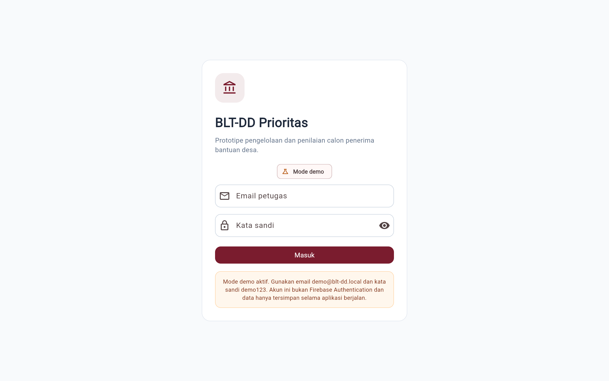 | 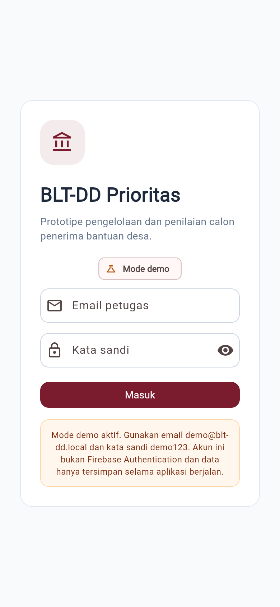 |
| Beranda | 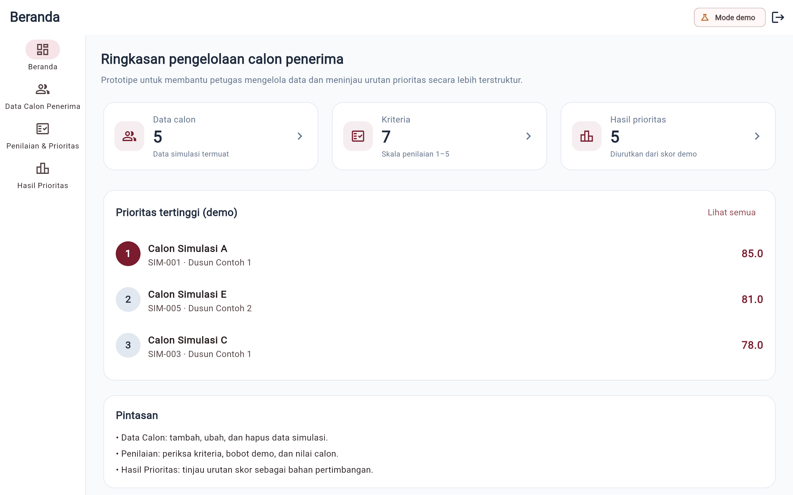 | 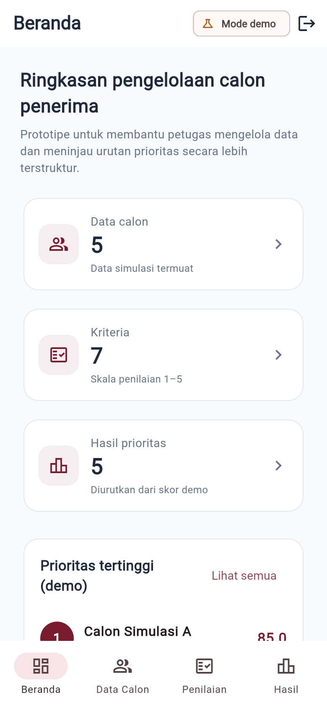 |
| Data calon | 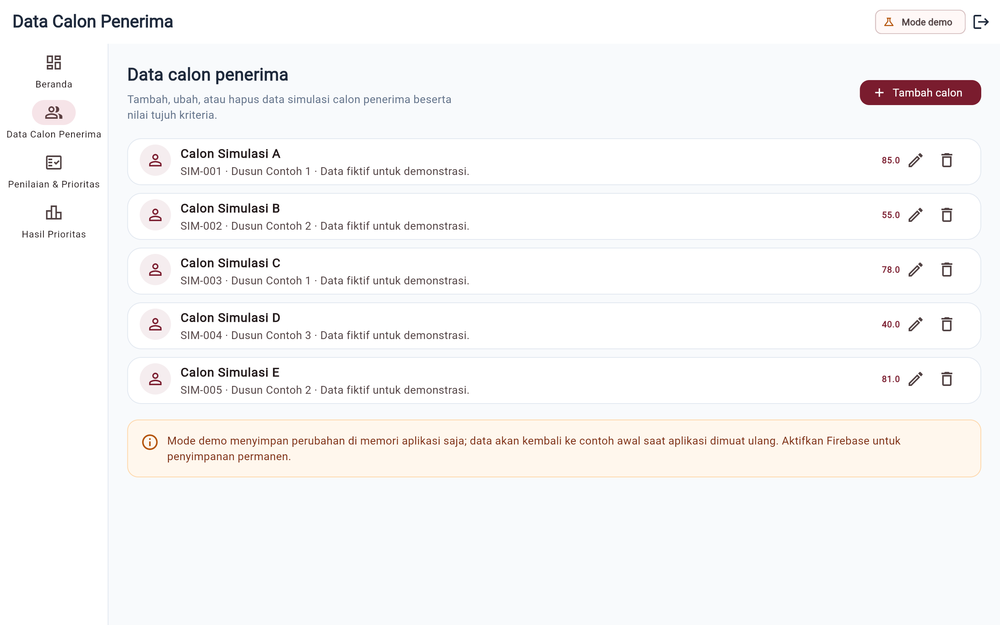 | 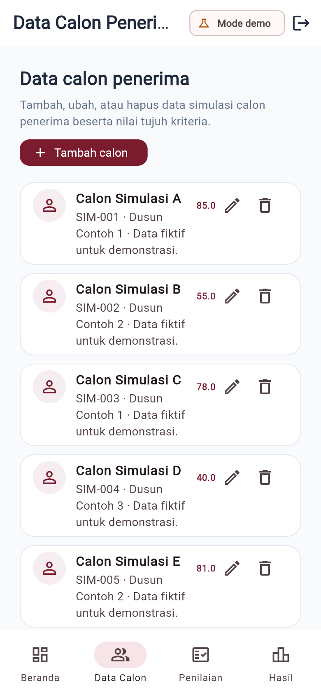 |
| Penilaian & prioritas | 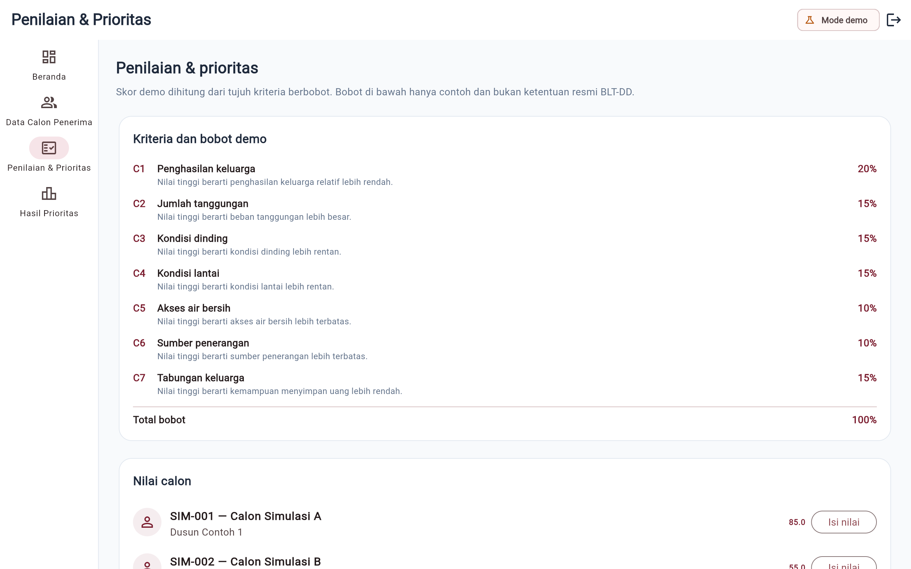 | 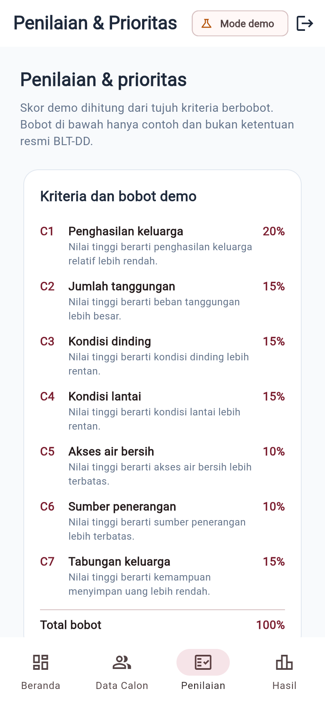 |
| Hasil prioritas | 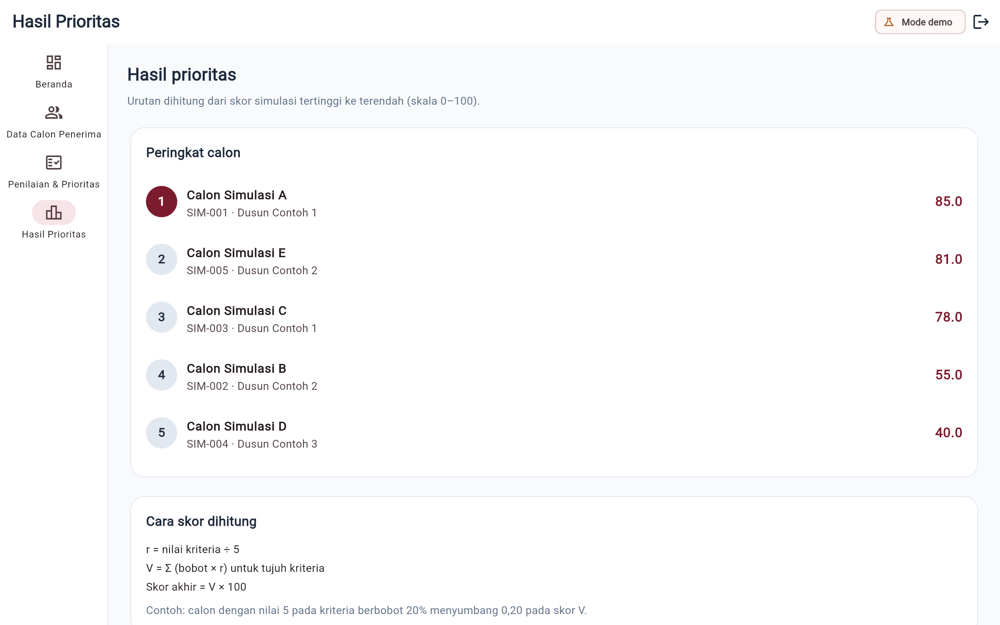 | 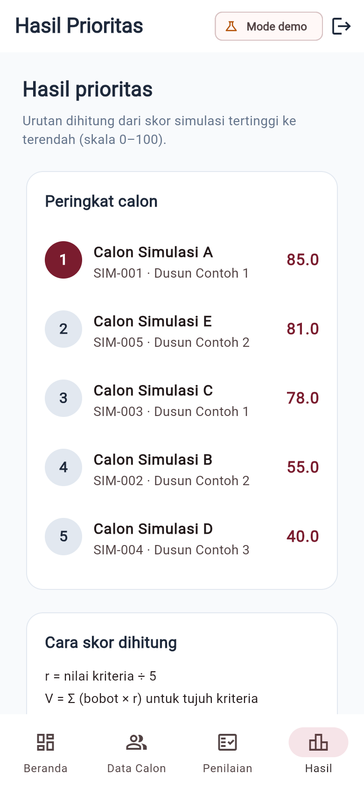 |
| Form tambah calon | 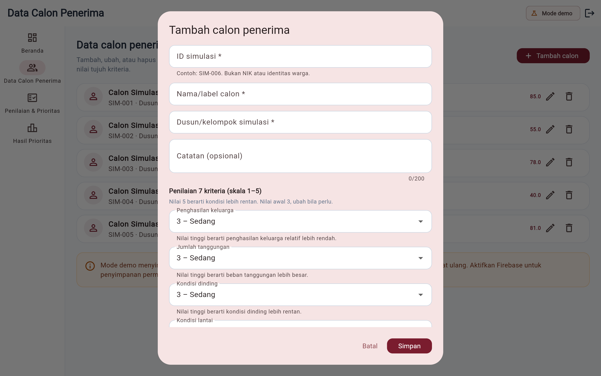 | 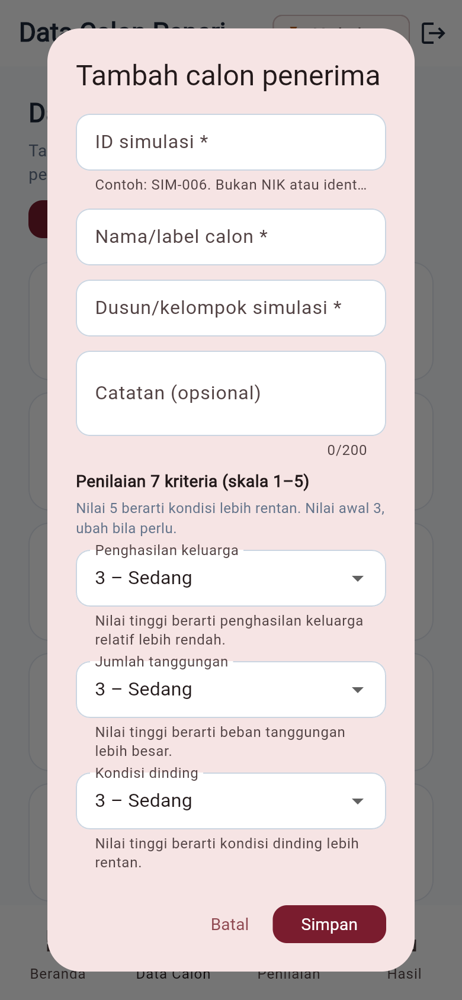 |
| Validasi form | 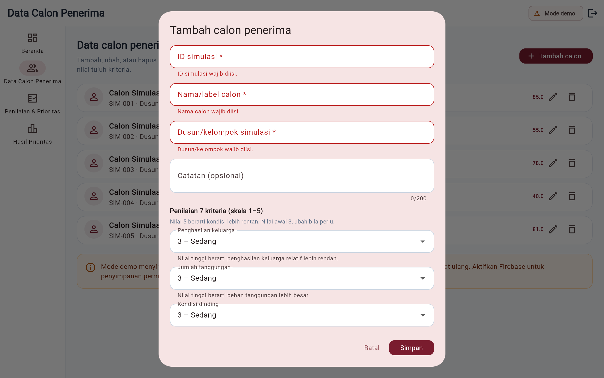 | 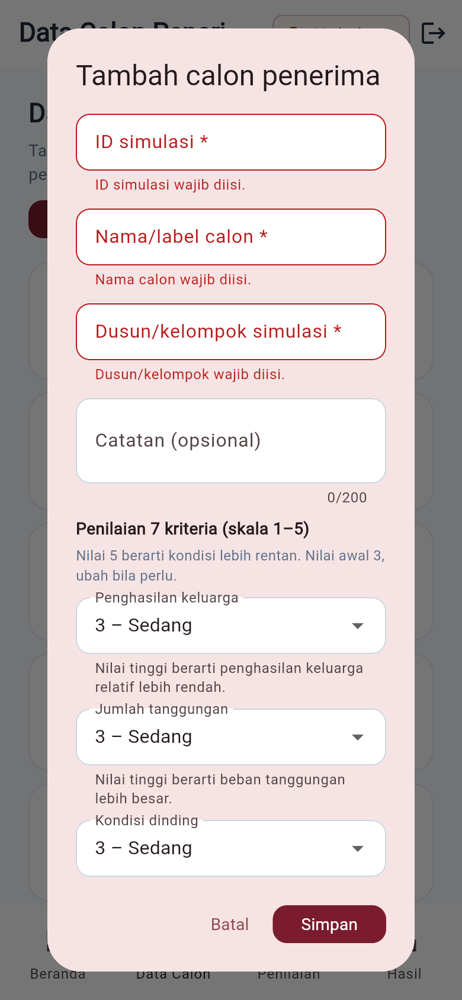 |

Wireframe rancangan awal tetap disimpan sebagai SVG di `docs/screenshots/` dan bukan bukti runtime.

## Proposal UTS

Proposal lengkap tersedia sebagai PDF 9 halaman: [docs/proposal/PROPOSAL_UTS.pdf](docs/proposal/PROPOSAL_UTS.pdf). Isinya mencakup identitas, latar belakang dan masalah, ruang lingkup, persona, sembilan user story, kebutuhan fungsional K-01–K-08, user flow, sitemap, lima wireframe, tech stack, rumus SAW, rancangan Firestore, keamanan, status verifikasi, dan tautan.

- Sumber HTML: [docs/proposal/PROPOSAL_UTS.html](docs/proposal/PROPOSAL_UTS.html)
- Sitemap versi Mermaid: [docs/rancangan/SITEMAP.md](docs/rancangan/SITEMAP.md)
- Peta kesesuaian butir UTS: [docs/UTS_CHECKLIST.md](docs/UTS_CHECKLIST.md)

**Catatan Figma:** proyek ini tidak memakai Figma karena tidak ada berkas Figma yang dibuat. Wireframe berupa SVG di `docs/screenshots/`, termasuk yang tertanam di proposal. Tautan Figma tidak dicantumkan karena belum ada; SVG dapat diimpor ke Figma bila diwajibkan.

## Video penjelasan

Video 16:9 berdurasi 5 menit 7 detik, di bawah batas 10 menit, menjelaskan masalah, pengguna utama, prioritas fitur, desain, demo prototipe, rencana teknis, dan empat pertanyaan wajib.

- Berkas: [docs/video/blt-dd-prioritas-promo.mp4](docs/video/blt-dd-prioritas-promo.mp4)
- Spesifikasi: 1920×1080, 30 fps, H.264 + AAC, suara Edge TTS `id-ID-ArdiNeural`, tanpa musik
- Isi per babak dan rincian produksi: [docs/VIDEO.md](docs/VIDEO.md)
- Sumber dan cara render: `video/` (Remotion)

Bagian demo memakai rekaman runtime aplikasi yang benar-benar dijalankan (login → beranda → data calon → validasi form → penilaian → hasil), bukan mockup. Firebase belum terhubung ke proyek nyata dan seluruh skor bersifat simulasi.

## Arsitektur dan struktur proyek

```
lib/
├── main.dart                  # bootstrap + gerbang login/mode dokumentasi
├── config/firebase_config.dart# opsi Firebase dari --dart-define
├── core/theme.dart            # warna, tema Material 3
├── data/data_simulasi.dart    # lima calon sintetis SIM-001..SIM-005
├── models/candidate_model.dart# Criterion, Candidate, rumus SAW, ranking
├── pages/
│   ├── login_page.dart
│   ├── app_shell.dart         # AppBar, navigasi responsif, CRUD, logout
│   ├── beranda_page.dart
│   ├── data_calon_page.dart   # daftar + dialog form tujuh kriteria
│   ├── penilaian_page.dart
│   └── hasil_prioritas_page.dart
├── services/app_backend.dart  # mode demo + Firebase Auth/Firestore
└── widgets/app_widgets.dart   # SummaryCard, SectionCard, InfoBanner, dll.
test/widget_test.dart          # 24 pengujian otomatis
tools/capture_screenshots.js   # skrip screenshot runtime
video/                         # sumber video Remotion + narasi Edge TTS
docs/                          # rancangan, Firebase, pengujian, presentasi
docs/video/                    # hasil render video penjelasan (MP4)
firestore.rules                # draft aturan akses berbasis role
firebase.json                  # konfigurasi Firestore rules + Hosting
```

Alur data: `AppShell` memuat daftar calon dari `AppBackend` → halaman menerima `List<Candidate>` → form mengirim `Candidate` kembali → backend menyimpan (memori atau Firestore) → daftar dimuat ulang → skor dihitung ulang oleh `rankCandidates()`.

## Alur pengguna

```
Login → Beranda → Data Calon Penerima → Penilaian & Prioritas → Hasil Prioritas → Keluar
```

- Login gagal menampilkan pesan validasi atau pesan autentikasi dan tetap di halaman Login.
- Login berhasil membuka Beranda dengan ringkasan yang dihitung dari data termuat.
- CRUD calon memakai dialog form yang sama untuk tambah dan ubah.
- Hapus selalu meminta konfirmasi dan menampilkan pesan berhasil/gagal.
- Keluar memanggil `signOut` dan kembali ke Login.

Rincian ada di [docs/rancangan/USER_FLOW.md](docs/rancangan/USER_FLOW.md).

## Menjalankan aplikasi (mode demo)

Prasyarat: Flutter SDK 3.47.7 (Dart 3.13.5), Git, dan Chrome. Android memerlukan Android SDK.

```bash
flutter pub get
flutter analyze
flutter test
flutter run -d chrome
```

Untuk build Web:

```bash
flutter build web
```

Akun demo lokal:

- Email: `demo@blt-dd.local`
- Kata sandi: `demo123`

Akun ini hanya berlaku pada mode demo dan bukan Firebase Authentication. Jangan memakai kata sandi ini untuk akun nyata.

### Mode dokumentasi (screenshot)

Build dengan `--dart-define=SCREENSHOT_MODE=true`, lalu buka `?page=N`:

| `page` | Halaman |
|---|---|
| 0 | Login |
| 1–4 | Beranda, Data Calon, Penilaian, Hasil |
| 5 | Data Calon + dialog form terbuka |
| 6 | Data Calon + dialog form dengan pesan validasi |

Mode ini hanya untuk dokumentasi dan tidak melewati autentikasi pada build normal.

## Konfigurasi Firebase

Kode membaca konfigurasi client dari `--dart-define` (lihat `lib/config/firebase_config.dart`):

- `FIREBASE_API_KEY`
- `FIREBASE_APP_ID`
- `FIREBASE_MESSAGING_SENDER_ID`
- `FIREBASE_PROJECT_ID`
- `FIREBASE_AUTH_DOMAIN` (opsional)
- `FIREBASE_STORAGE_BUCKET` (opsional, tidak dipakai fitur saat ini)

Contoh (placeholder, isi dengan nilai project Anda):

```bash
flutter run -d chrome \
  --dart-define=FIREBASE_API_KEY=ISI_SENDIRI \
  --dart-define=FIREBASE_APP_ID=ISI_SENDIRI \
  --dart-define=FIREBASE_MESSAGING_SENDER_ID=ISI_SENDIRI \
  --dart-define=FIREBASE_PROJECT_ID=ISI_SENDIRI
```

Jika konfigurasi tidak lengkap atau inisialisasi gagal, aplikasi tetap berjalan di mode demo dan menampilkan label yang sesuai. Panduan lengkap: [docs/firebase/SETUP_FIREBASE.md](docs/firebase/SETUP_FIREBASE.md).

Untuk web publik di GitHub Pages, workflow membaca nilai yang sama dari repository secrets (`FIREBASE_API_KEY`, `FIREBASE_APP_ID`, `FIREBASE_MESSAGING_SENDER_ID`, `FIREBASE_PROJECT_ID`, `FIREBASE_AUTH_DOMAIN`, `FIREBASE_STORAGE_BUCKET`). Tanpa secrets, build publik tetap mode demo. Tambahkan juga `bamsuti.github.io` ke Authorized domains di Firebase Authentication.

**Yang belum dilakukan:** project Firebase belum dibuat/dihubungkan, Email/Password belum diaktifkan untuk aplikasi ini, akun uji dan role belum dibuat, rules belum diuji di Emulator Suite, dan Hosting belum di-deploy.

## Keamanan dan privasi

- Tidak ada password, private key, token, atau service account di repository ini.
- Kredensial demo (`demo@blt-dd.local` / `demo123`) adalah akun sintetis internal mode demo, bukan akun layanan nyata.
- Data contoh memakai label fiktif (`Calon Simulasi A`–`E`, `SIM-001`–`SIM-005`), bukan NIK atau data warga.
- `firestore.rules` **tidak** membuka akses publik: hanya user terautentikasi dengan dokumen `users/{uid}` berrole `admin`/`petugas` yang boleh mengakses data operasional, dan dokumen `users` tidak dapat ditulis dari client.
- Rules masih draft dan wajib diuji di lingkungan non-produksi sebelum dipakai.

## Pengujian

Lingkungan: Windows, Flutter 3.47.7 stable, Dart 3.13.5.

| Pemeriksaan | Perintah | Hasil |
|---|---|---|
| Analisis statis | `flutter analyze` | **No issues found** |
| Test otomatis | `flutter test` | **24 test, semua lulus** |
| Build Web | `flutter build web` | **Berhasil** |
| Screenshot runtime | Chrome headless terhadap build Web | **14 file** (7 halaman × 2 viewport) |
| Video penjelasan | `npm run render` di `video/` | **Berhasil**; 5 menit 7 detik, 1920×1080, audio AAC terverifikasi |
| Deploy web (GitHub Pages) | Workflow `Deploy Web to GitHub Pages` | **Berhasil**; halaman publik merespons 200 dan tampilan login terverifikasi |
| Build Android | GitHub Actions `flutter build apk --debug` | **Berhasil**; belum dijalankan di perangkat |
| Firebase Auth/Firestore | — | **Belum diuji** (project belum dikonfigurasi) |
| Login Firebase | Build dengan `--dart-define` atau secrets Pages | **Kode siap; belum diuji** tanpa project nyata |
| Firebase Hosting | — | **Belum di-deploy** |

CI: [run #7](https://github.com/Bamsuti/BLT-DD-prioritas/actions/runs/40902045482) — prepare, analyze, 24 test, build Web, dan build APK debug semuanya berhasil.

Cakupan 24 test otomatis: tujuh kriteria & total bobot, rentang skor, urutan ranking, tie-break, serialisasi dan kontrak field Firestore, CRUD mode demo, penolakan ID duplikat, login demo salah/benar, validasi email & kata sandi, logout, navigasi lebar/sempit, validasi form, tambah/ubah/hapus, perubahan nilai memengaruhi skor, dan mode dokumentasi.

Matriks skenario lengkap beserta status per skenario: [docs/PENGUJIAN.md](docs/PENGUJIAN.md).

## Status verifikasi

| Area | Status |
|---|---|
| Kode inti, form, navigasi | Selesai, `flutter analyze` bersih |
| Mode demo in-memory | Berfungsi, diuji otomatis |
| Test otomatis | 24/24 lulus |
| Build Web | Berhasil |
| Screenshot runtime | Tersedia dan diambil dari build Web |
| Video penjelasan | Dirender 31 Oktober 2026; 5:07, 1080p, delapan babak, narasi Edge TTS, demo runtime asli, tanpa musik |
| Proposal UTS | PDF 9 halaman dengan persona, sembilan user story, kebutuhan, user flow, sitemap, wireframe, tech stack, dan rancangan Firestore |
| Deploy web | GitHub Pages aktif 29 Oktober 2026; aplikasi berjalan mode demo |
| Scaffold Android | Tersedia (Gradle Kotlin DSL, `minSdk` mengikuti Flutter, izin INTERNET) |
| Build Android | APK debug berhasil dibangun di GitHub Actions; belum diuji di perangkat/emulator |
| Firebase Auth + Firestore | Kode siap; belum dihubungkan/diuji |
| Login Firebase | Alur Email/Password, pemulihan sesi, dan pesan error siap; menunggu project Firebase milik pengguna |
| Firestore rules | Draft; belum diuji/deploy |
| CI GitHub Actions | Berhasil (run #7): analyze, 24 test, build Web, build APK debug |
| Firebase Hosting | Belum di-deploy |

## Roadmap

1. Membuat project Firebase, mengaktifkan Email/Password, dan menguji Auth + CRUD di Emulator Suite.
2. Menguji rules (user tanpa role, role petugas, akses tulis `users`).
3. Build dan uji APK di perangkat/emulator Android.
4. Deploy Firebase Hosting setelah build Web final.
5. Menyimpan snapshot hasil per periode + versi bobot dan audit trail.
6. Validasi persona, bobot, subkriteria, dan formula bersama dosen/petugas.

Rincian: [docs/ROADMAP.md](docs/ROADMAP.md).

## Dokumentasi

- [Proposal UTS (PDF)](docs/proposal/PROPOSAL_UTS.pdf)
- [Checklist kesesuaian UTS](docs/UTS_CHECKLIST.md)
- [Identitas, kebutuhan, dan keterlacakan](docs/rancangan/KEBUTUHAN.md)
- [Persona](docs/rancangan/PERSONA.md)
- [User story](docs/rancangan/USER_STORY.md)
- [User flow](docs/rancangan/USER_FLOW.md)
- [Sitemap](docs/rancangan/SITEMAP.md)
- [Wireframe](docs/rancangan/WIREFRAME.md)
- [Rancangan database](docs/rancangan/DATABASE.md)
- [Panduan Firebase](docs/firebase/SETUP_FIREBASE.md)
- [Matriks pengujian](docs/PENGUJIAN.md)
- [Panduan presentasi UTS](docs/PRESENTASI_UTS.md)
- [Roadmap](docs/ROADMAP.md)
- [Keterangan screenshot](docs/screenshots/README.md)
- [Video penjelasan (spesifikasi dan produksi)](docs/VIDEO.md)

---

Prototipe ini dibuat untuk keperluan akademik. Skor dan peringkat yang dihasilkan tidak boleh digunakan sebagai dasar keputusan penerima bantuan tanpa verifikasi dan musyawarah resmi.
