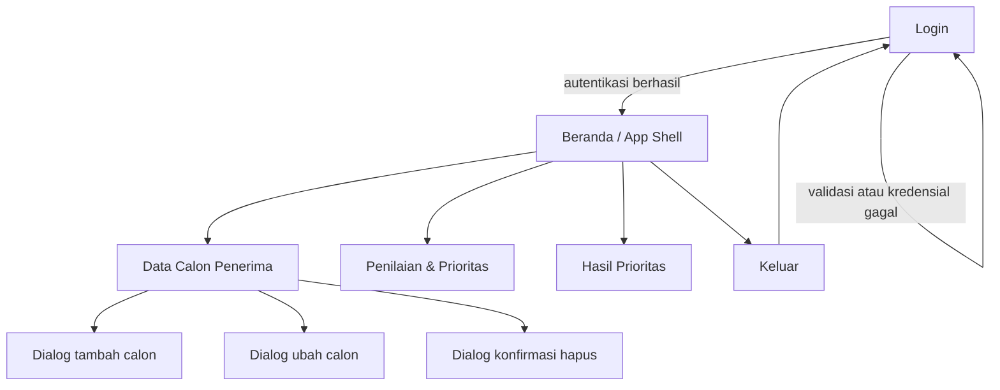

# Sitemap — BLT-DD Prioritas

Sitemap menjelaskan hierarki halaman dan jalur navigasi yang tersedia setelah login. Semua halaman berada dalam satu `AppShell` dengan `NavigationRail` pada layar lebar dan `NavigationBar` pada layar sempit.

## Hierarki halaman

| Level | Halaman | Fungsi utama | Navigasi |
|---|---|---|---|
| 0 | Login | Validasi email/kata sandi, autentikasi, status mode | Tidak ada navigasi sebelum login |
| 1 | Beranda | Ringkasan jumlah calon, kriteria, hasil, dan pintasan | Rail/bar |
| 2 | Data Calon Penerima | Daftar, tambah, ubah, hapus, dan validasi form | Rail/bar |
| 2 | Penilaian & Prioritas | Tujuh kriteria, bobot demo, pintasan isi nilai | Rail/bar |
| 2 | Hasil Prioritas | Skor 0–100, urutan menurun, penjelasan rumus | Rail/bar |
| 3 | Dialog form calon | Tambah/ubah dengan tujuh nilai kriteria | Modal dari Data Calon |
| 3 | Dialog konfirmasi hapus | Konfirmasi sebelum menghapus | Modal dari Data Calon |

## Aturan navigasi

- Pengguna yang belum login hanya melihat Login; halaman operasional tidak dapat dibuka dari alur normal.
- Login berhasil membuka Beranda; Login gagal tetap di Login dengan pesan.
- Semua halaman operasional dapat dibuka dari rail/bar tanpa kehilangan sesi.
- Keluar mengakhiri sesi dan kembali ke Login.
- Breakpoint 760 px: di bawahnya memakai `NavigationBar`, pada atau di atasnya memakai `NavigationRail`.

## Hubungan dengan user flow

Sitemap ini adalah versi hierarkis dari alur `Login → Beranda → Data Calon → Penilaian → Hasil → Keluar`. Rincian langkah dan kondisi gagal ada di [USER_FLOW.md](USER_FLOW.md). Wireframe tiap halaman ada di [WIREFRAME.md](WIREFRAME.md).
